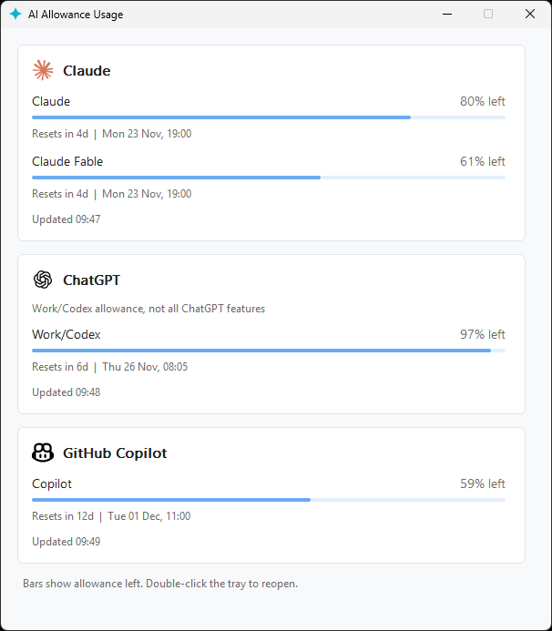
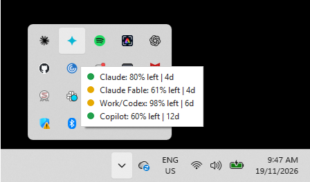

# AI Allowance

**Know what's left. See when it resets. Keep working.**

Your Claude, ChatGPT Work/Codex and GitHub Copilot allowances in one native
Windows tray app. Check remaining usage and reset times without switching
between account pages.



**A hover for the essentials. A double-click for the details.** Hover over
the starburst tray icon for a compact summary with usage-pace traffic
lights. Double-click to open the dashboard above.



Separate quotas get separate entries, including Claude's overall and
model-scoped (for example Fable) weekly windows and multiple Work/Codex
buckets. Percentages are never added together, and the app never invents a
percentage without a valid denominator.

**Status:** first working version. The tray application builds and runs on
Windows 11 x64. Claude and Work/Codex collection has been validated against
live accounts. Copilot quota collection through GitHub CLI has also been
validated live, using an explicitly experimental interface (see
[docs/provider-validation.md](docs/provider-validation.md)).

## What works

- Native tray icon with a hover popup and right-click-only menu. A single
  left click does not open the menu. Double-click with the left button for
  a centered native usage window with Claude, ChatGPT and GitHub Copilot
  cards with original provider logos and separate slim allowance-left bars
  for each available window. Unknown allowances show usage text instead of
  a misleading bar. The Refresh button (or F5) refreshes every enabled
  provider on demand, and each card shows "Refreshing" until its provider
  responds.
- Dialog type follows Claude's settings dialog: 14px body text, 12px
  captions and 15px semibold headings. Claude's own typeface is proprietary
  and is not bundled; the app uses Segoe UI, Claude's Windows fallback.
  Provider logos are multi-size icons rendered from the providers' vector
  marks and loaded at the exact drawn size.
- Hover rows project how much allowance will be used by reset at the
  current average rate. Green means under 90% projected use, amber means
  90% through 100%, and red means over 100% or already exhausted. During
  the first 10% of a window, the projection uses 10% as its minimum elapsed
  time so a small burst just after reset does not trigger a warning.
  A hollow grey circle means pace is unknown or the reset is being checked.
- Cached values show immediately; hovering refreshes providers whose data is
  older than 60 seconds, concurrently and with one request in flight per
  provider. Countdown text updates locally without network requests.
- Explicit per-provider states: loading, ready, stale (last good values are
  kept when a refresh fails), sign-in required, rate limited, unavailable,
  error and not configured. One provider's failure never hides another's
  data.
- Context menu: per-window details with exact local reset times and last
  update time, Refresh now, Open usage pages, native Settings dialog,
  checked Start with Windows toggle, Quit.
- Settings pages for general preferences, provider configuration and
  per-provider Chrome profiles. Saving applies changes without restarting.
  Every executable, folder and Chrome profile field has a Browse button
  that opens the native Windows Explorer picker.
  Copilot uses your existing GitHub CLI authentication, without storing
  credentials in the app.
- Optional background polling (default 5 minutes) and toast notifications at
  20% and 10% remaining plus confirmed resets, deduplicated per window and
  reset cycle. Notifications require polling to be useful unattended.
- Single application instance; no console window in release builds; no
  telemetry, server or database. Usage snapshots stay in memory.

## Providers

| Provider | Source | Notes |
| --- | --- | --- |
| Claude | Claude Agent SDK experimental usage API via a pinned Node.js helper | Experimental: the SDK method may change in any release. Uses your existing Claude Code sign-in. No prompt is submitted and no tokens are consumed. |
| Work/Codex | Official local `codex app-server` (`account/rateLimits/read`) | Uses your existing ChatGPT sign-in. Covers the Work/Codex buckets only, not other ChatGPT feature limits. Never consumes rate-limit reset credits. |
| Copilot | `gh api /copilot_internal/user` quota snapshots | Experimental internal interface, deliberately enabled at the maintainer's request. Uses the active GitHub CLI sign-in and the reported allowance and remaining percentage. Unlimited buckets are not presented as finite allowances. |

## Requirements

- Windows 11 x64.
- Rust stable 1.85+ (tested with 1.97.1) to build.
- For Claude: Node.js 23.6+ on PATH and an existing Claude Code sign-in.
- For Work/Codex: a codex CLI (`codex` on PATH, the binary bundled with the
  ChatGPT VS Code extension is found automatically, or set
  `providers.codex.command`).
- For Copilot: GitHub CLI (`gh`) on PATH, signed in using `gh auth login`,
  or set `providers.copilot.command` to its executable.

## Build and run

```text
cargo build --release
npm install --prefix helpers/claude-usage
target\release\ai-allowance.exe
```

The helper install is only needed for the Claude provider. When the app runs
from a different directory, copy `helpers\claude-usage` (with its
`node_modules`) next to the executable or set `providers.claude.helper_dir`.

Run the tests (synthetic fixtures only, no credentials needed):

```text
cargo fmt --check
cargo clippy --all-targets -- -D warnings
cargo test
```

## Windows installer

With NSIS 3 installed, build the release executable first, then package it
into the per-user Windows x64 installer in PowerShell:

```powershell
cargo rustc --release --locked --target-dir target\installer-build --bin ai-allowance -- -C target-feature=+crt-static
.\installer\build.ps1
# If NSIS is not on PATH:
.\installer\build.ps1 -MakeNsis "${env:ProgramFiles(x86)}\NSIS\makensis.exe"
```

The packaging script uses the prebuilt executable without compiling it or
restoring provider dependencies. The release build above statically links
the Visual C++ runtime, avoiding a machine-wide runtime installation.
Output: `target\installer\ai-allowance-windows-x64-setup.exe`.
The installer is currently unsigned. The filename stays the same across
versions; the installer still embeds the package version.

After building, run installer smoke tests with `.\installer\test.ps1`
(the same `-MakeNsis` option is supported). Tests redirect registry paths,
shortcuts and files to isolated current-user test locations. They verify
startup defaults, quoting, preservation of unrelated values and preferences,
running-instance protection, and uninstall with startup enabled or disabled.
Interactive wizard appearance and an actual Windows sign-in remain manual
checks.

Setup installs into `%LOCALAPPDATA%\Programs\AI Allowance` without elevation.
It extracts the tray executable, uninstaller, license and README, then adds
per-user shortcuts and registration. It does not build, download, install or
run any provider tooling. For Claude usage, set up the optional helper
separately with `npm ci --prefix helpers/claude-usage` from this repository
and point Settings > Providers at the resulting `helpers\claude-usage`
folder. Without that helper, Claude usage is unavailable on a clean install.
Codex and Copilot keep using their existing CLI integrations.

If you already installed the earlier package that bundled Claude, quit the
tray app and uninstall that version first to remove its bundled files.
The earlier uninstaller preserves `config.toml`. The new installer does not
delete existing helper files during an upgrade.

Start with Windows is selected by default on the components page; clear it
to skip enabling startup. **Launch AI Allowance** is checked by default on the
finish page. Clear it to finish setup without opening the app.

Startup uses only the `AIAllowance` string value in
`HKEY_CURRENT_USER\Software\Microsoft\Windows\CurrentVersion\Run`, containing
the quoted full executable path. The tray menu checkmark reflects that entry.
Unchecking deletes only that value; checking writes it back. Errors are shown
in a dialog instead of silently reporting success. Portable builds do not
enable startup unless it was already enabled.

All installer registry writes, uninstall registration and Start menu shortcuts
are per-user. No machine-wide keys, other startup values, authentication,
PATH or system settings are changed. Quit the tray app before installing,
upgrading or uninstalling. Uninstall removes its startup value only if it
still points to that installation, and preserves `config.toml` and unknown
files in the installation directory. Uninstall is available in Windows
Installed apps or the user's Start menu.

## Configuration

Use the tray menu's Settings dialog to configure the app. Preferences live
in `config.toml` next to the executable, so that directory must be writable.
On first run, an existing `%APPDATA%\AIAllowance\config.toml` is copied there
without changing the original. Otherwise a default file is created.
The portable file takes precedence on subsequent runs. Manual edits are
read on restart; settings saved through the dialog apply immediately.
Existing Start with Windows entries are updated to the renamed executable
when the new app starts, without enabling startup for users who opted out.

Copilot is enabled by default and reuses the active GitHub CLI account.
An existing configuration that disabled Copilot keeps that preference;
enable it in Settings > Providers. No account name or allowance total is
required:

```toml
[providers.copilot]
enabled = true
# command = 'C:\Program Files\GitHub CLI\gh.exe'
```

The app runs this read-only quota check without starting a model turn:

```text
gh api /copilot_internal/user --jq '{plan: .copilot_plan, reset: .quota_reset_date, quota: .quota_snapshots}'
```

Settings > General > Tray tooltip chooses the rows shown on hover. With
Automatic selected it shows the first window of each provider plus Claude
Fable, when present. Clear Automatic to tick specific rows; the list fills
in after the first successful refresh. Windows limits the hover summary to
about four rows (127 UTF-16 units), so all windows always remain visible in
the usage window and the menu. In `config.toml` an empty `tooltip.windows`
means Automatic; otherwise it lists window ids such as `claude:overall`,
`claude:model:fable`, `codex:codex:primary` or `copilot:premium_interactions`.

### Browser profiles

Settings > Browser profiles accepts separate Chrome profile directories for
Claude, ChatGPT and GitHub Copilot. Browse opens Chrome's User Data folder;
pick the profile folder (for example `Default` or `Profile 1`) and the app
stores its folder name. Only folders directly inside a Chrome user data
folder are accepted. You can also find the name in `chrome://version` under
Profile Path. Chrome is located in standard installation directories,
or you can specify its executable.

Blank profile fields use the system default browser. A configured profile
opens Chrome directly with `--profile-directory`, without changing browser
defaults or signing you in. For example:

```toml
[browser]
claude_profile = "Profile 1"
codex_profile = "Default"
copilot_profile = "Profile 2"
```

The Copilot usage link opens <https://github.com/settings/copilot/features>.
Chrome must already have the desired accounts signed into those profiles.

## Known issues and limitations

- The Claude usage API is explicitly experimental; a future SDK release may
  break it. The helper is pinned to `@anthropic-ai/claude-agent-sdk 0.3.325`.
- Claude refreshes take several seconds because the helper spawns the SDK
  runtime each time.
- Copilot's internal quota endpoint is not a public compatibility contract.
  It can change or become unavailable. Reset dates are interpreted as UTC;
  zero per-bucket reset timestamps use the reported monthly date.
- The hover popup is custom painted so each row can carry a coloured
  traffic light. It still selects whole rows within 127 UTF-16 units;
  additional windows remain available in the usage dialog and menu.
- The popup opens and closes on the shell's own hover notifications. The
  app subclasses tray-icon's hidden window and switches the icon to
  `NOTIFYICON_VERSION_4` without `NIF_SHOWTIP`, which also stops Windows 11
  showing an empty native tooltip box. This relies on tray-icon's private
  callback message (6002, checked against tray-icon 0.21.3); if the switch
  fails, the popup falls back to tray-icon's enter/leave events.
- Checks that need interactive sessions (suspend/resume, Explorer restart,
  display scaling changes) are manual; see docs/provider-validation.md for
  what was and was not verified.
- The native dialogs have automated Windows control tests. Visual checks
  across multiple monitors, taskbar themes and scale changes still need
  manual validation.

## Development

Read [AGENTS.md](AGENTS.md) before making changes. Provider adapters live in
`src/providers/` and are independent of the tray UI (`src/tray.rs`,
Windows-only). Parsing is tested against synthetic fixtures in
`tests/fixtures/`. [CI](.github/workflows/ci.yml) runs formatting, Clippy,
unit tests, and installer smoke tests on Windows for pushes and pull
requests to `main`. No live credentials are needed. Changes to Rust
(`.rs`) files outside `.github/` and `docs/` must increase the package
version in `Cargo.toml` and update `Cargo.lock`.

To publish, push a `vMAJOR.MINOR.PATCH` tag that matches the version in
`Cargo.toml`. The [release workflow](.github/workflows/release.yml) builds
the Windows x64 installer and attaches it to the GitHub release as
`ai-allowance-windows-x64-setup.exe`.

The tray icon is the Aven Solutions starburst favicon; see
[assets/ATTRIBUTION.md](assets/ATTRIBUTION.md) for provenance. The icon is
not covered by the MIT code license.

## License

MIT, see [LICENSE](LICENSE). Third-party dependencies and branding retain
their own terms.

AI Allowance is an independent project and is not affiliated with Anthropic,
OpenAI or GitHub.
